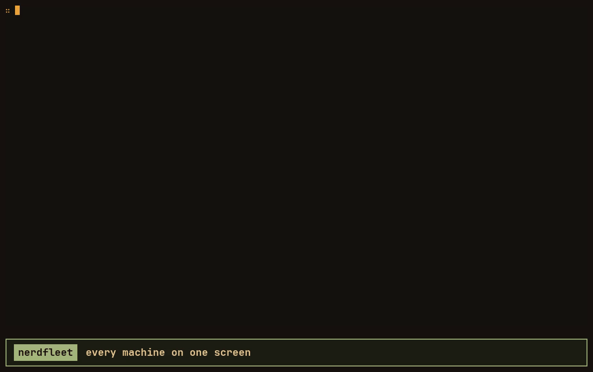

<p align="center">
<picture>
    <source media="(prefers-color-scheme: dark)" srcset="docs/logo/nerdfleet-on-dark.svg">
    <source media="(prefers-color-scheme: light)" srcset="docs/logo/nerdfleet-on-light.svg">
    
</picture>
</p>

<p align="center">Linux · macOS viewer (untested) · <a href="LICENSE">MIT license</a></p>



<p align="center"><sub>The hosts in this recording are simulated; <a href="docs/demo/README.md">how it is made</a>.</sub></p>

Watch a fleet of machines from one terminal: what each one is training or serving, how hard its CPUs, memory and
GPUs are working, and a terminal on any of them a keystroke away. For AI/ML engineers and researchers whose work is
spread over GPU boxes, model servers and workstations.

nerdfleet reaches your hosts over your own SSH setup and needs nothing installed on them: it copies a small agent
there and runs it as you. NVIDIA, AMD and Intel GPUs are found on any host, mixed ones included, and unified-memory
machines (AMD APUs) show the shared memory their models actually live in. It is built on
[nerdmux](https://github.com/Ndles/nerdmux), shares its look, and opens each host's own nerdmux in its terminal, so
every machine has the same interface.

## Install

Releases carry one binary per platform: `x86_64-linux`, `aarch64-linux` and `aarch64-macos` (Apple Silicon, which
watches Linux hosts). Each one includes the agents for x86_64 and aarch64 Linux, built for glibc 2.28 and newer, so it
reaches RHEL 8-era machines and ARM boxes too.

```sh
f=nerdfleet-0.2.2-x86_64-linux     # or -aarch64-linux, -aarch64-macos
curl -fLO https://github.com/Ndles/nerdfleet/releases/download/v0.2.2/$f
curl -fLO https://github.com/Ndles/nerdfleet/releases/download/v0.2.2/$f.sha256
sha256sum -c $f.sha256
install -m 755 $f ~/.local/bin/nerdfleet
```

On a Mac, check it with `shasum -a 256 -c` instead, and fetch it with `curl` as above: a copy downloaded in a browser
is quarantined by Gatekeeper. The Mac viewer is built and tested in CI, but nobody has run it on a Mac yet; if you do,
an issue saying how it went, good or bad, helps.

## Build

Needs Rust 1.88 or newer. nerdfleet uses nerdmux's terminal as a library, at the commit `Cargo.toml` pins; Cargo
fetches it.

```sh
cargo install --path . --locked   # puts `nerdfleet` in ~/.cargo/bin
scripts/release.sh                # or: release builds for x86_64 and aarch64 Linux, in dist/
```

A build from `cargo install` carries no agents and copies itself to hosts instead, so it reaches only hosts like the
machine it was built on. `scripts/release.sh` builds the agents the releases carry; it needs Docker, zig and
[cargo-zigbuild](https://github.com/rust-cross/cargo-zigbuild). With [just](https://github.com/casey/just), `just`
lists the common tasks, and `just fleet` opens nerdfleet in a window of your nerdmux session.

To try a nerdmux change in nerdfleet before it is pushed, build against a checkout next to this one:

```sh
cargo build --config 'patch."https://github.com/Ndles/nerdmux".nerdmux.path="../nerdmux"'
```

That points `Cargo.lock` at the checkout, so put it back (`git checkout Cargo.lock`) rather than commit it. To ship
the change, push nerdmux, set its new commit as `rev` in `Cargo.toml` and run `cargo update -p nerdmux`.

Releases are built on GitHub: a tag `vX.Y.Z` that matches `Cargo.toml` runs the tests, builds the three viewers and
publishes them; "Run workflow" builds them without publishing.

## Getting started

`nerdfleet add` lists the hosts in your `~/.ssh/config`, `Include`d files too, and adds the ones you pick to
`~/.config/nerdfleet/config.toml`; `nerdfleet add gpu-box` adds one by name. Your comments in that file stay. It can
also be written by hand (`nerdfleet config` prints an example). Each host is an alias from `~/.ssh/config`, which keeps
the address, user, key and jump hosts:

```toml
[[host]]
name = "gpu-box"
ssh = "gpu-box"

[[host]]
name = "laptop"
local = true        # the machine nerdfleet runs on
```

```sh
nerdfleet add             # pick hosts from ~/.ssh/config
nerdfleet                 # the overview
nerdfleet check           # what is wrong with the config, if anything
nerdfleet probe gpu-box   # connect to one host and print what it reports
```

| You want to                                 | Press                         |
|---------------------------------------------|-------------------------------|
| move between hosts                          | `←` `↓` `↑` `→`               |
| open a host: graphs, workloads, processes   | `Enter`, and `Esc` to go back |
| switch the graphs between 15m, 6h and 24h   | `t`                           |
| a terminal on the host, beside its stats    | `s`, and `s` again to put it away |
| that terminal on the whole screen           | `z`                           |
| move the keys between dashboard and terminal | `Ctrl+]`                     |
| try a host that went away again             | `r`                           |
| update a resident agent older than nerdfleet | `u`                          |
| quit                                        | `q`                           |

Each card lists what the host is doing: model servers (`INFR`), GPU jobs (`TRAIN`) and jobs keeping the CPUs busy
(`CPU`), named the way you would name them (`torchrun train.py`, `llama-swap · Qwen3-8B-Q4_K_M`). The host view adds
graphs, every GPU in full, each workload's models, processes and command line (with keys and passwords masked on the
host), and the busiest processes.

## Terminals

`s` opens a terminal on the host beside its graphs and processes, side by side on wide screens and one above the
other on narrower ones. It runs the host's own nerdmux, status bar, windows and keys included, attached to your last
session there, so the session outlives a dropped connection and the next `s` picks it up. A host without nerdmux gets a
login shell, which ends with the connection.

Every key goes to the terminal except `Ctrl+]`, which gives the keys to the dashboard; the part that has them is
outlined, as nerdmux outlines its focused pane. `s` again puts the terminal away, still running; `z` gives it the whole
screen. A terminal whose program ends closes by itself. Hosts cannot set this machine's clipboard or ring its bell.

The mouse works too. A click moves the keys to the half it lands in, and the wheel scrolls whatever is under the
pointer: the terminal's program or scrollback, the selected host, or the selected workload. Clicks and drags in a
terminal go to its program. Since nerdfleet takes the mouse, your own terminal selects text with `Shift` held down,
which is also how to copy from a host's terminal: what its nerdmux copies stays on the host.

## Resident agents

By default the agent on a host runs only while you watch. To keep 24 hours of history and get alerts while you are
away (a training run that stalls, a model server or run that ends, a disk filling up, a host that disappears), make it
resident:

```sh
nerdfleet resident enable gpu-box     # a systemd user service; no root needed
nerdfleet resident status gpu-box
nerdfleet resident disable gpu-box    # --purge also removes its saved history
```

Alerts show on the host's card and in its view, and as desktop notifications while nerdfleet runs. A user service
stops at your last logout unless lingering is on for your user; `enable` tells you, and prints the command an admin
would run. After you update nerdfleet, a resident agent older than it says so on its card, and `u` updates it; its
history and alerts stay. Running `enable` again does the same.

## How it reaches hosts

- **Your own SSH setup.** nerdfleet runs the system `ssh` with the host's alias, so the address, user, key, jump hosts
  and host keys all come from `~/.ssh/config`. The config file has no place for passwords, tokens or keys. One SSH
  connection per host is shared by everything nerdfleet opens there, so a password or second factor is asked once.
- **No ports, no daemons, no root.** On first contact nerdfleet copies its agent to `~/.cache/nerdfleet/` on the host
  (mode 700, checked against its SHA-256 before every start). It runs as you, only reads `/proc`, `/sys` and the GPU
  drivers, and exits when you quit, unless you made it resident.
- **Hosts are not trusted.** Everything an agent sends is size-limited and cleaned of escape sequences before it is
  drawn, so a compromised machine cannot take over the terminal that watches it.
- **It gives up politely.** A host that goes away is tried 8 times over about three minutes, and its card says which
  try is next; then nerdfleet waits for `r`. A refused key or an unknown host key is not retried at all.

To report a security problem, see [SECURITY.md](SECURITY.md).

## Things worth knowing

- **The look** comes from `~/.config/nerd-theme.toml`, the theme the Nërd tools share, and follows it while nerdfleet
  runs; see [nerdmux](https://github.com/Ndles/nerdmux#configuration) for what it can set.
- **Inside nerdmux.** When nerdfleet itself runs in nerdmux, that nerdmux keeps its own keys (`Alt+Space`,
  `Alt+arrows`), so press its leader twice to reach a host's nerdmux. On the machine nerdfleet runs on, the terminal is
  then a plain shell, since attaching to your own session would draw nerdfleet inside itself.
- **GPUs that sleep stay asleep.** A laptop's discrete GPU that is powered down is shown as asleep, not woken to be
  measured.

## Status

Working: live hosts and what they run, the host view with 24 hours of history, resident agents with alerts, and
terminals. Next: Slurm clusters (relay, job steps, a cluster view), and Macs as hosts. The macOS viewer is built and released but not yet tried on a Mac.

## License

[MIT](LICENSE).
